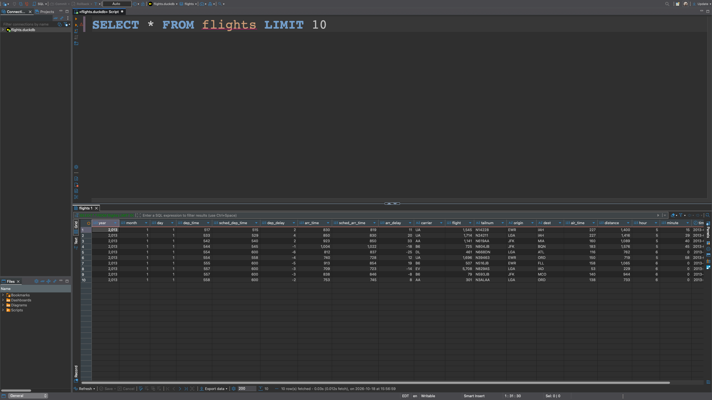
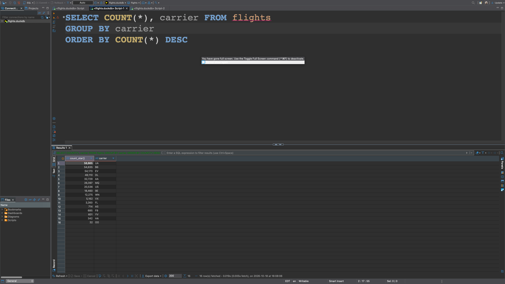
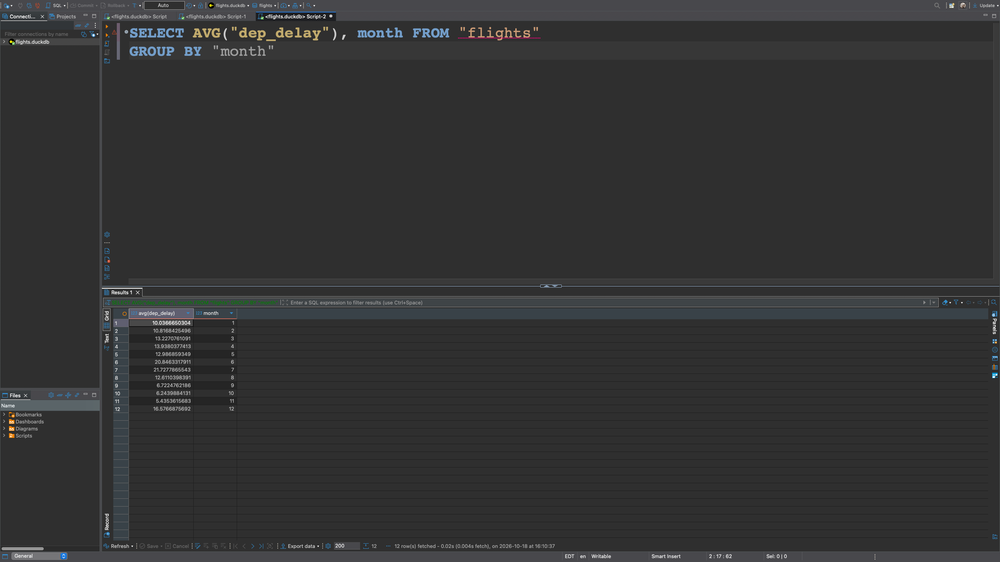
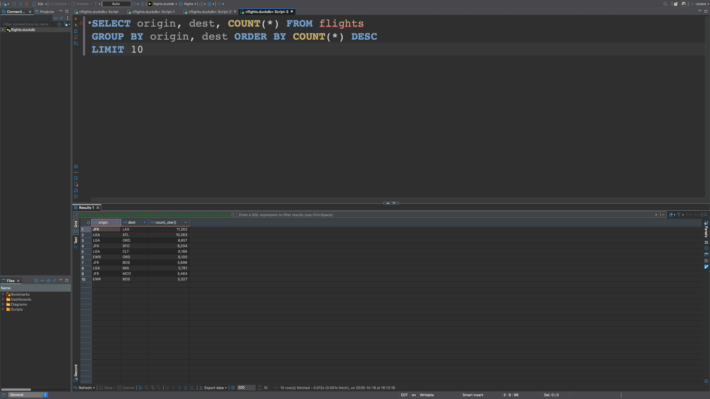

```{r}
# Load required libraries
#| warning: FALSE
#| output: FALSE
invisible(lapply(c("DBI", "duckdb", "nycflights13"), 
                 library, character.only=TRUE))
```

```{r}
# Establish database connection 
#| warning: FALSE
#| error: FALSE
#| output: FALSE
suppressMessages(connection <- DBI::dbConnect(drv = duckdb::duckdb(), 
                             dbdir = "./data/flights.duckdb")) 
```

# Part I: Answer the following question by running SQL using RStudio.

## Section 1.a: List the first 10 rows of the flights table.

We select all the rows with the asterisk symbol and limit our output to the first 10 rows.

```{r}
# Get the first ten rows of the flights table
dbGetQuery(connection, "SELECT * FROM flights LIMIT 10")
```

## Section 1.b: Find the number of flights

i. **in the dataset**

We use the count function to count all the rows in the flights table.

```{r}
# Get the total count of rows in the flights table
dbGetQuery(connection, "SELECT COUNT(*) FROM flights")
```

ii. **for each carrier**

We use the count function to count all the rows in the table, and we select the carrier column from the flights table. Then we group by each unique carrier, and order the table by the grouped counts of rows in descending order.

```{r}
# Get the count of rows for each airline carrier
dbGetQuery(connection, "SELECT COUNT(*), carrier FROM flights GROUP BY carrier ORDER BY COUNT(*) DESC")
```

## Section 1.c: Find the average departure delay (dep_delay)

We use the average function on the `dep_delay` column of the flights table calculate the average departure delay.

```{r}
# Get the mean of dep_delay from the flights table
dbGetQuery(connection, "SELECT AVG(dep_delay) FROM flights")
```

## Section 1.d: Find the top 5 destinations (dest) With the most flights.

We use the count function on the destination column and select the destinations from the flights table initially. Then we group by unique destinations and order the table by the counts of destinations in descending order. Finally we limit the ouput to the top five rows.

```{r}
# Group by destinations, count the number of observations for each destination,
# order by the counts in descending order, and limit the output to the top five.
dbGetQuery(connection, "SELECT COUNT(dest), dest FROM flights GROUP BY dest 
           ORDER BY count(dest) DESC LIMIT 5")
```

## Section 1.e: Create a table showing:

1. **carrier**

2. **average arrival delay (arr_delay)**

\

**Sort the results from largest to smallest delay. You must close the connection when you are done. Use `dbDisconnect()`**

We first select as our columns carrier and use the averge function on `arr_delay` from the flights table. Then we group by carrier and order by the average arrival delay in descending order.

```{r}
# Group by carriers and calculate the mean arrival delay. Then order
# by the means in descending order.
dbGetQuery(connection, "SELECT carrier, AVG(arr_delay) FROM flights 
           GROUP BY carrier ORDER BY AVG(arr_delay) DESC")
```

```{r}
# Close the database connection
DBI::dbDisconnect(connection)
```

# Part II

## Section 2.a: List the first 10 rows of the flights table.

We select all the rows from the flights table with the asterisk and then limit our results to the top ten rows.



## Section 2.b: Count the Number of Flights for Each Carrier

**Your output should include:**

1. **carrier**
 
2. **number of flights Sort from the largest to smallest.**

We select the counts of all the rows and the carrier column from the flights table. Then we group by carrier, and we order by the row counts in descending order.



## Section 2.c: Find the average departure delay by month

**Your output should include:**

1. **month**

2. **average departure delay**

We first select the average function with the `dep_delay` column and select the month column from the flights table. Then we group by month.



## Section 2.d: Find the top 10 routes (dest) by:

1. **origin**

2. **dest**

**ordered by number of flights.**



## Section 2.e : Export Part II Section b results

**Export the result of part b query to a CSV file using the Export Data feature in DBeaver.**

**Submit the exported CSV file along with your homework.**

```{=latex}
\begin{center}
    \textit{This is the end of the assignment.}
\end{center}
```


